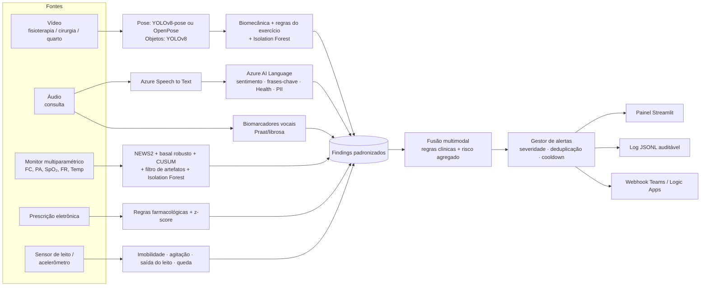

# Relatório Técnico — MedWatch

**Tech Challenge Fase 4 · Pós-Tech IA para Devs (FIAP)**
Monitoramento multimodal de pacientes com detecção de anomalias em tempo real e serviços Azure.

---

## 1. Problema e objetivo

O hospital já usa IA para analisar exames e documentos. O próximo passo é **monitorar continuamente** o
paciente usando dados de naturezas diferentes — vídeo, áudio e texto/sinais — para identificar **sinais
precoces de risco** e avisar a equipe a tempo de agir.

Objetivos atendidos:

1. Analisar e **fundir** texto, áudio, vídeo e séries temporais;
2. Usar **serviços gerenciados em nuvem** (Azure Speech to Text e Azure AI Language/Text Analytics);
3. Aplicar **detecção de anomalias em tempo real** e gerar **alertas** priorizados para a equipe médica.

## 2. Arquitetura e fluxo multimodal



**Contrato comum.** Todo analisador devolve `Finding(patient_id, modality, kind, severity, score, message,
timestamp, end_timestamp, evidence)`. Isso desacopla as modalidades: a fusão e os alertas não sabem como
cada achado foi produzido, só o que ele significa. Severidades: `INFO < ATENÇÃO < URGENTE < CRÍTICO`.

**Tempo real.** O detector de sinais vitais é um *monitor de streaming* (`StreamingVitalsMonitor.update`)
que processa uma amostra por vez e emite um alerta quando um episódio **abre** ou **piora** — não a cada
amostra. O mesmo código é usado em lote (`detect_vitals_anomalies`) e no comando `stream`, que reproduz
um CSV como se as amostras chegassem do monitor.

**Fluxo do alerta.** Finding → `AlertManager` (descarta abaixo da severidade mínima; deduplica por paciente
e episódio/tipo; reenvia só se a severidade subir) → canais: console, JSONL (trilha de auditoria) e webhook
no formato MessageCard (Teams) com **conduta sugerida** por tipo de evento.

## 3. Modelos e técnicas por tipo de dado

### 3.1 Vídeo

| Etapa | Técnica |
|---|---|
| Pose | **YOLOv8n-pose** (Ultralytics, 17 pontos COCO) — padrão; **OpenPose** COCO-18 (CMU) via OpenCV DNN, convertido para COCO-17 |
| Objetos e áreas críticas | **YOLOv8n** (COCO) + zonas poligonais configuráveis (`configs/zones.json`) |
| Rastreamento | pessoa principal = maior caixa; nos quadros seguintes, a mais próxima da anterior |
| Biomecânica | ângulos de abdução do ombro, flexão de cotovelo/joelho, inclinação lateral do tronco, postura (em pé/sentado/deitado), velocidade vertical do quadril normalizada pela altura do corpo, índice de tremor (2ª diferença das trajetórias dos punhos) |
| Repetições | picos/vales do ângulo principal do exercício (`scipy.signal.find_peaks`) |
| Detecção | regras por exercício (amplitude mínima, assimetria E/D, compensação de tronco), queda (descida rápida do quadril + tronco horizontal mantido), tremor (limiar robusto calibrado nas repetições iniciais), paciente fora do campo, e **Isolation Forest** em janelas de 1 s calibrado no início da sessão para padrões atípicos sem regra |
| Cirurgia | objetos proibidos no campo estéril, excesso de pessoas, **contagem de instrumentais** início × fim (possível item retido) |
| Saída | relatório Markdown com tabela de repetições e desvios, gráfico da linha do tempo e **vídeo anotado** com esqueleto e faixa de alerta |

Robustez em vídeo real: pontos com confiança < 0,3 viram NaN e são interpolados; quadros sem pessoa visível
e trocas de identidade (salto horizontal > 3 alturas/s) zeram as velocidades, evitando "quedas" falsas
quando alguém entra ou sai de cena; o tremor só é avaliado com o corpo parado.

### 3.2 Áudio

| Etapa | Técnica |
|---|---|
| Transcrição | **Azure Speech to Text** (pt-BR), reconhecimento contínuo, saída detalhada com *timestamps* por palavra (taxa de fala em palavras/min) |
| Texto | **Azure AI Language**: `analyze_sentiment` (com opinion mining), `extract_key_phrases`, **Text Analytics for Health** (`pt`; sintomas, medicamentos, negação), `recognize_pii_entities` (texto anonimizado — LGPD) |
| Termos críticos | léxico clínico pt-BR → categorias (respiratório, cardiovascular, neurológico, fadiga, infecção, hemorrágico) com tratamento de negação ("não tenho febre", "sem dor no peito") |
| Biomarcadores | **Praat/parselmouth**: jitter local, shimmer local, HNR; **librosa**: F0 (pYIN), atividade de fala, taxa silábica, pausas, duração de frases, inspirações audíveis (ruído não-vozeado de espectro plano nas pausas), queda de energia e de F0 do 1º para o último terço |
| Condições | escores 0–1 por rampa entre valor normal e alterado; **disartria** (jitter, shimmer, lentificação, pausas longas, HNR), **dificuldade respiratória** (inspirações audíveis, HNR, razão de pausas), **fadiga vocal** (queda de energia e F0, lentificação) |
| Fusão áudio+texto | `escore = 1 − (1 − acústico)·(1 − 0,6·texto)`; disartria acústica + relato neurológico agudo ⇒ CRÍTICO (protocolo AVC) |

Se as credenciais Azure não estiverem configuradas, a transcrição vem de um `.txt` ao lado do WAV e a análise
de texto usa o léxico local — o pipeline continua executável em desenvolvimento e nos testes.

### 3.3 Sinais vitais (séries temporais)

Quatro camadas, todas em streaming:

1. **NEWS2** (Royal College of Physicians) + regra de crise hipertensiva (PAS ≥ 180 ou PAD ≥ 120):
   total ≥ 7 → CRÍTICO; 5–6 → URGENTE; um parâmetro com 3 pontos → ATENÇÃO.
2. **Desvio do basal do próprio paciente**: z-score robusto (mediana/MAD) numa janela de 6 h com
   defasagem de 30 min — detecta mudança *antes* de cruzar limiares absolutos (**sinal precoce**).
3. **CUSUM** sobre |z| acima de 2σ: acumula pequenos desvios persistentes (deterioração lenta).
4. **Filtro de artefatos**: salto fisiologicamente implausível de 1–2 amostras (ex.: SpO₂ 97 → 72 → 97)
   é descartado e registrado como `possivel_artefato` (INFO).

Persistência (3 de 5 amostras alteradas) evita alertas por amostra isolada; episódios fecham após 15 min
normais. Complementarmente, **Isolation Forest** multivariado (valores normalizados por paciente +
inclinações de 15 min) gera um escore de anomalia por minuto exibido no painel.

### 3.4 Prescrições

Regras farmacológicas (base simplificada): dose diária acima da máxima, **interações graves**
(ex.: varfarina + AAS), **suspensão abrupta** de fármacos que exigem desmame (betabloqueador, corticoide),
**duplicidade terapêutica** por classe, **escalonamento** ≥ 100 % em ≤ 6 h, **instabilidade** (≥ 4
alterações em 6 h) e um **z-score robusto** da variação relativa de dose frente ao histórico, para capturar
mudanças incomuns sem regra explícita.

### 3.5 Movimentação na internação

Série por minuto (atividade, decúbito, pico de impacto) de sensor de leito/acelerômetro — ou derivada
do vídeo de quarto (`pose_to_activity`). Detecta **imobilidade > 2 h** (lesão por pressão), **agitação**
(z-score robusto contra o perfil do próprio paciente dia/noite — possível delirium), **saída do leito à
noite** (risco de queda) e **queda** (impacto ≥ 3 g seguido de imobilidade).

### 3.6 Fusão multimodal

*Late fusion* em dois níveis:

* **Regras de correlação clínica** numa janela de 12 h, avaliadas **incrementalmente** — o achado fundido
  nasce no primeiro instante em que a evidência é suficiente, e evidências posteriores são anexadas como
  corroboração. Severidade = maior severidade das evidências + 1 nível.

  | Síndrome | Evidências (≥ 2 fontes) | Obrigatória |
  |---|---|---|
  | `suspeita_avc` | disartria na voz, crise hipertensiva, assimetria/amplitude reduzida no vídeo, relato neurológico | — |
  | `suspeita_sepse` | deterioração/febre/taquicardia/hipotensão, fadiga vocal ou queixa infecciosa, mudanças de prescrição, imobilidade | sinais vitais |
  | `insuficiencia_respiratoria` | dessaturação/taquipneia, padrão vocal respiratório ou queixa | sinais vitais |
  | `queda_com_instabilidade` | queda (sensor ou vídeo), instabilidade hemodinâmica/respiratória | sinais vitais |

* **Risco agregado do paciente** (curva no painel): `1 − Π(1 − w_modalidade · w_severidade · escore ·
  e^(−Δt/6h))`.

## 4. Resultados

### 4.1 Protocolo de avaliação

Dados reais de hospital não podem ser publicados, então o repositório traz **24 h de 4 pacientes com
eventos injetados e rotulados** (`data/demo/ground_truth.json`). O P003 é **controle negativo** (estável,
com artefatos de sensor). Métrica por evento: um evento é detectado se algum achado ≥ ATENÇÃO se sobrepõe a
ele; precisão = fração dos achados que correspondem a algum evento. Reprodução: `python -m medwatch demo`
(resultados em `outputs/metricas.json`).

### 4.2 Desempenho por modalidade

| Modalidade | Eventos | Detectados | Recall | Precisão | Observação |
|---|---|---|---|---|---|
| Sinais vitais | 5 | 5 | 1,00 | 1,00 | 6 leituras de artefato descartadas; 0 alertas no controle |
| Prescrições | 6 | 6 | 1,00 | 1,00 | 7 achados (inclui duplicidade de betalactâmicos) |
| Movimentação | 4 | 4 | 1,00 | 1,00 | queda classificada como CRÍTICO |
| Áudio | 3 | 3 | 1,00 | 1,00 | voz saudável (P003) sem achados; acústica sozinha já aponta a condição certa |
| Vídeo | 4 | 4 | 1,00 | 1,00 | intervalos detectados coincidem com os injetados (±0,5 s) |

Resumo da execução: **36 alertas** em 24 h para 4 pacientes (11 CRÍTICO, 13 URGENTE, 12 ATENÇÃO), nenhum
para o paciente controle.

> Os valores perfeitos refletem dados sintéticos com eventos bem definidos; servem para validar a lógica de
> ponta a ponta, **não** estimam o desempenho clínico. A seção 6 descreve a validação necessária com dados reais.

### 4.3 Exemplos de anomalias detectadas

**Sinal precoce de sepse (P001).** A deterioração começa às 14h00 como uma rampa lenta. O monitor emite
**ATENÇÃO às 15h57** por desvio persistente do basal (FC, FR e temperatura ainda abaixo dos limiares
NEWS2), **URGENTE às 18h29** (febre + taquipneia) e **CRÍTICO às 19h42** (NEWS2 ≥ 7). A fusão gera
`suspeita_sepse` (CRÍTICO) às 15h57, combinando fadiga vocal na consulta das 13h00, imobilidade de 3,9 h
desde 15h08 e o desvio dos vitais — **cerca de 3h45 antes** de os sinais vitais sozinhos chegarem a CRÍTICO.
Depois, o escalonamento de noradrenalina (+200 % em 1 h) é anexado como corroboração.

**Suspeita de AVC (P004).** Crise hipertensiva às 10h28 (PAS até ~200 mmHg) → na fisioterapia das 12h00 o
vídeo mostra **amplitude do ombro direito de 77° vs 170° à esquerda** (assimetria de 103°) com compensação de
tronco → `suspeita_avc` CRÍTICO às 12h00; a consulta das 13h00 corrobora com **disartria** (jitter 3,8 %,
2,2 sílabas/s, pausas de 0,9 s) e o relato "fala enrolada… boca dormente do lado direito".

**Queda com instabilidade (P002).** Agitação noturna 02h16 → saída do leito 02h40 → queda 02h48 (impacto
6,5 g + imobilidade) → dessaturação 03h07 ⇒ `queda_com_instabilidade` CRÍTICO.

**Prescrição (P004).** Suspensão abrupta de metoprolol 200 mg/dia (09h00), seguida de AAS em paciente com
varfarina (interação, 11h00) e captopril 200 mg/dia acima da máxima de referência (11h12).

**Vídeo de fisioterapia (P004)** — relatório gerado automaticamente:

| severidade | evento | intervalo | descrição |
|---|---|---|---|
| ATENÇÃO | amplitude_reduzida | 24,1–39,9 s | Repetições 7–10: amplitude máx. 77° no lado direito (esperado ≥ 140°) |
| ATENÇÃO | assimetria | 24,1–39,9 s | Assimetria E/D de 103° |
| ATENÇÃO | compensacao_tronco | 24,1–39,9 s | Inclinação lateral do tronco de 14° |
| ATENÇÃO | movimento_irregular | 40,1–48,7 s | Oscilação de alta frequência dos punhos (índice 0,134 vs limiar 0,037) |
| CRÍTICO | queda | 52,5 s → | Quadril desceu 0,7 alturas/s e o tronco ficou a 87° da vertical |

**Biomarcadores vocais** (valores medidos):

| Paciente | Jitter % | Shimmer % | HNR dB | Sílabas/s | Pausa média s | Inspirações/min | Energia Δ% | Condição (escore) |
|---|---|---|---|---|---|---|---|---|
| P001 | 1,36 | 11,6 | 16,3 | 3,4 | 0,39 | 0 | −11,0 | fadiga vocal (0,91) |
| P002 | 1,16 | 12,0 | 10,4 | 4,0 | 0,52 | 25,7 | −5,4 | dificuldade respiratória (0,95) |
| P003 | 0,67 | 8,5 | 22,5 | 4,6 | 0,26 | 0 | +5,6 | — |
| P004 | 3,85 | 15,4 | 11,0 | 2,2 | 0,90 | 0 | −2,5 | disartria (0,996) |

**Vídeo real.** Testado com YOLOv8n-pose em vídeo público com pessoas entrando e saindo de cena
(Intel IoT sample videos): pose e esqueleto corretos, períodos sem pessoa marcados como
`paciente_fora_do_campo`, sem falsos positivos de queda após o tratamento de troca de identidade.

## 5. Integração Azure

| Serviço | Uso | Código |
|---|---|---|
| Azure AI Speech — Speech to Text | Transcrição pt-BR com timestamps por palavra | `AzureSpeechTranscriber` |
| Azure AI Language — Sentiment + Opinion Mining | Estado emocional do paciente | `AzureTextAnalyzer._azure` |
| Azure AI Language — Key Phrase Extraction | Queixas principais | idem |
| Azure AI Language — Text Analytics for Health | Sintomas/medicamentos com negação | idem |
| Azure AI Language — PII | Texto anonimizado para log (LGPD) | idem |
| Webhook (Teams Workflows / Azure Logic Apps) | Entrega do alerta; Logic Apps pode encaminhar a e-mail/SMS (Azure Communication Services) | `WebhookChannel` |

Credenciais só via `.env`; falhas de rede/cota caem no modo offline com log de aviso, sem derrubar o
monitoramento.

## 6. Limitações e próximos passos

* **Validação clínica.** Recalibrar limiares com dados reais e anotados do hospital: PhysioNet (BIDMC,
  MIMIC-III Waveform) para vitais; gravações de referência no mesmo microfone/sala para voz (ex.: corpus
  TORGO para disartria); vídeos de fisioterapia anotados por fisioterapeutas.
* **Áudio sintético.** A voz de demonstração é sintetizada (fonte glotal + formantes) e não contém palavras;
  por isso a transcrição de demonstração vem do `.txt`. Com gravações reais o Azure Speech transcreve de fato.
* **Instrumentais cirúrgicos.** O COCO só tem proxies (tesoura, faca). Em produção, re-treinar o YOLOv8 com
  um dataset de instrumentais (ex.: imagens anotadas de bandejas cirúrgicas).
* **OpenPose** exige `opencv-python<5` (o OpenCV 5 removeu o importador Caffe) e os pesos da CMU (licença
  não comercial). O backend padrão é YOLOv8-pose.
* **Base farmacológica** simplificada — integrar a uma base validada e à farmácia clínica.
* **Fadiga de alarmes.** Já há deduplicação/cooldown; o próximo passo é medir a taxa de alarmes por
  paciente-dia com a equipe e ajustar severidade mínima por unidade.
* **Escala.** Trocar o loop de streaming por Azure Event Hubs + Azure Functions/Stream Analytics e persistir
  findings em Cosmos DB; o contrato `Finding` já é serializável em JSON.
* **Ética e regulação.** Apoio à decisão, nunca decisão autônoma; consentimento para gravação; dados
  anonimizados (PII do Azure Language); software como dispositivo médico segue a RDC ANVISA 657/2022.

## 7. Reprodutibilidade

```bash
pip install -r requirements.txt && python scripts/download_models.py
python -m medwatch demo        # gera outputs/: alerts.jsonl, findings.json, metricas.json, painel_alertas.html, gráficos, vídeo anotado
pytest -q                      # 27 testes (detectores, Azure com mock, fusão, alertas, pipeline completo)
streamlit run app/dashboard.py
```
